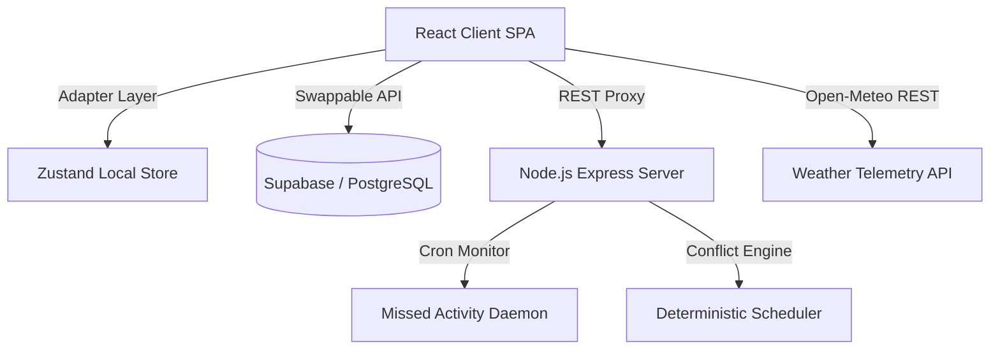

# TimeWise Architecture & System Design

## 1. System Overview
TimeWise is structured into three cleanly decoupled layers:
1. **Frontend Presentation & State Layer (`/client`)**:
   - Single-Page Application (SPA) driven by Vite, React 18, and React Router v6.
   - Glassmorphic SaaS design system utilizing Tailwind CSS custom tokens.
   - Central reactive Zustand store (`useStore`) with automatic browser persistence.
   - Web Audio API procedural synthesizer for offline ambient focus sounds.
   - Leaflet + OpenStreetMap for geospatial visualization.
   - Live weather telemetry powered by the open Open-Meteo API.

2. **Backend API & Scheduling Daemon (`/server`)**:
   - Express REST API with TypeScript and CORS middleware.
   - Node-cron background watcher for identifying missed timetable activities.
   - Deterministic, explainable rule-based scheduling engine for task allocation.

3. **Database & Migration Layer (`/supabase`, `/database`)**:
   - PostgreSQL schema with 27 normalized tables.
   - UUID keys, foreign key constraints with cascade deletes.
   - Row Level Security (RLS) policies enforcing multi-tenant user isolation.

## 2. Key Subsystems
- **Conflict Detection Engine**:
  Computes direct time overlaps and validates physical transit buffers between venues based on `travelTimeMinutes`.
- **Explainable Smart Planner**:
  Takes circadian energy curves (Morning peak vs evening flow), user wake/sleep preferences, priority scores, and weather warnings to output clean recommendations with transparent "Why this slot?" justifications.
- **Ambient Synthesizer**:
  Procedural sound generation via `AudioContext.createBufferSource` and bandpass/lowpass biquad filters—zero external audio assets needed.

